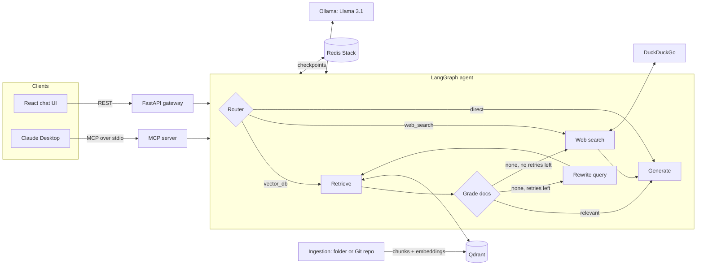

# ContextEngine

[](https://github.com/fahimtakin/context-engine/actions/workflows/ci.yml)
     

**A local-first, self-correcting RAG assistant for your documents and codebases, available as a REST API, a React chat UI, and an MCP server for Claude Desktop.**

ContextEngine indexes local folders or any public Git repository into Qdrant, then answers questions through a LangGraph agent. The agent routes each question to your index, the web, or a direct reply. It grades what it retrieves, rewrites the query and searches again when retrieval misses, and falls back to web search when the index has nothing useful. Conversation memory persists per session in Redis. The LLM, embeddings and vector store all run locally through Ollama and Docker, with no paid API keys.

<!-- TODO: add a screenshot or GIF of the chat UI, e.g.  -->

---

## Features

- **Corrective RAG loop.** An LLM grader filters retrieved chunks for relevance. If nothing relevant survives, the agent rewrites the query and retrieves again, up to a configurable retry limit, then falls back to web search instead of answering from bad context.
- **Agentic routing.** Structured LLM output (validated with Pydantic) routes each question to vector retrieval, live web search (DuckDuckGo), or a direct reply. Greetings are detected without an LLM call.
- **Source-cited answers.** Every response returns the files or URLs it was grounded in.
- **Index any Git repo or local folder.** Shallow clone over https, 20+ source file types, build artifacts and oversized files filtered out, file-path and repo metadata on every chunk.
- **Multi-turn memory.** State is checkpointed to Redis Stack per `thread_id`. Per-turn context is reset each turn, so an old answer's documents never leak into a new one.
- **Three interfaces, one core:** a FastAPI REST API, a React chat console, and an MCP server for Claude Desktop.
- **Resilient by design.** If Ollama, Qdrant or Redis is unavailable, the affected step degrades (router defaults to retrieval, grader fails open, Redis falls back to an in-memory checkpointer) instead of crashing the request.
- **Production basics.** `/health` and `/ready` endpoints, structured logging to stderr, a non-root multi-stage Docker image with a healthcheck, env-based config with no secrets in the image, an offline test suite, and CI on every push.
- **Measured, not guessed.** A built-in evaluation harness scores routing accuracy and retrieval quality (hit rate, MRR, context precision) with and without the corrective loop.

## Architecture



**Request flow:** a question arrives through the API or MCP. The router classifies it. On the retrieval path, the top-k chunks from Qdrant are graded one by one; only relevant chunks reach the generator. If none survive, the query is rewritten and retrieval runs again (default: one rewrite), then web search takes over. The generator answers from the kept context and returns its sources, and the turn is checkpointed to Redis under the session's `thread_id`.

**Ingestion flow:** files are loaded, split with `RecursiveCharacterTextSplitter` (1000-character chunks), embedded with `mxbai-embed-large` (1024 dimensions) and stored in Qdrant with cosine distance.

## Tech stack

| Layer | Technology |
|---|---|
| Agent orchestration | LangGraph, LangChain |
| LLM and embeddings | Ollama: Llama 3.1, mxbai-embed-large |
| Vector database | Qdrant |
| Session memory | Redis Stack (`langgraph-checkpoint-redis`) |
| API | FastAPI, Uvicorn, Pydantic |
| Tool protocol | Model Context Protocol (MCP) Python SDK |
| Frontend | React 19, Vite, Tailwind CSS |
| Quality | pytest, Ruff, GitHub Actions |
| Infrastructure | Docker (multi-stage), Docker Compose |

## Project structure

```
context-engine/
├── app/
│   ├── agents/          # state, nodes (router, retrieve, grade, rewrite, web search, generate), graph
│   ├── core/            # settings, Ollama clients with Docker host discovery, logging
│   ├── db/              # Qdrant client and vector store
│   ├── mcp/server.py    # MCP server exposing ContextEngine as tools
│   ├── services/        # local-folder and Git-repo ingestion
│   └── main.py          # FastAPI app (chat, indexing, health)
├── evaluation/          # question set, metrics and evaluation runner
├── tests/               # offline test suite (no Ollama, Qdrant or Redis needed)
├── context-engine-ui/   # React + Vite chat console
├── documents/           # sample documents for local ingestion
├── .github/workflows/   # CI: lint, format check, tests, Docker build
├── Dockerfile
└── docker-compose.yml
```

## Getting started

### Prerequisites

- [Docker](https://www.docker.com/) with Docker Compose
- [Ollama](https://ollama.com/) running on the host, with the models pulled:
  ```bash
  ollama pull llama3.1
  ollama pull mxbai-embed-large
  ```
- Node.js 18+ for the UI

### 1. Configure (optional)

```bash
cp .env.example .env
```

The defaults work for running locally. Docker Compose sets the container-specific hosts for you.

### 2. Start the backend

```bash
docker compose up --build
```

This starts the API on `http://localhost:8000`, Qdrant on `6333` and Redis Stack on `6380`. Interactive API docs are at `http://localhost:8000/docs`. Check `http://localhost:8000/ready` to confirm Qdrant and Ollama are reachable.

### 3. Index something

A Git repository:

```bash
curl -X POST http://localhost:8000/api/index-git \
  -H "Content-Type: application/json" \
  -d '{"repo_url": "https://github.com/<owner>/<repo>", "branch": "main"}'
```

Or the local `documents/` folder (outside Docker, in a Python environment):

```bash
pip install -r requirements.txt
python run_ingestion.py            # or: python run_ingestion.py path/to/folder
```

### 4. Chat

```bash
curl -X POST http://localhost:8000/api/chat \
  -H "Content-Type: application/json" \
  -d '{"message": "How does authentication work in this repo?", "thread_id": "demo"}'
```

```json
{
  "response": "...",
  "thread_id": "demo",
  "router_decision": "vector_db",
  "sources": ["https://github.com/owner/repo:src/auth.py"],
  "retries": 0,
  "used_web_fallback": false
}
```

Reuse the same `thread_id` to continue the conversation with memory.

### 5. Run the UI

```bash
cd context-engine-ui
npm install
npm run dev
```

## Using it from Claude Desktop (MCP)

Add ContextEngine to `claude_desktop_config.json`:

```json
{
  "mcpServers": {
    "context-engine": {
      "command": "python",
      "args": ["/absolute/path/to/context-engine/app/mcp/server.py"]
    }
  }
}
```

| Tool | What it does |
|---|---|
| `ask_context_engine(query, session_id)` | Runs a question through the agent with session memory and returns the answer with its sources |
| `index_local_knowledge_base(directory_path)` | Indexes the `.md`, `.txt` and `.py` files in a local folder (rebuilds the collection) |
| `index_remote_github_repository(repository_url, branch_name)` | Clones a public repo over https and adds it to the index |

The MCP server logs to stderr so logs never corrupt the stdio JSON-RPC channel.

## API reference

| Method | Endpoint | Body | Description |
|---|---|---|---|
| `POST` | `/api/chat` | `{ message, thread_id? }` | Answer, session id, route taken, sources, number of rewrites, and whether web fallback was used |
| `POST` | `/api/index-git` | `{ repo_url, branch? }` | Clone, chunk, embed and store a public https repository; returns file and chunk counts |
| `GET` | `/health` | | Liveness |
| `GET` | `/ready` | | Readiness: Qdrant and Ollama reachability, active checkpointer (503 when degraded) |

## Configuration

All settings are environment variables (or `.env`); see `.env.example`.

| Variable | Default | Purpose |
|---|---|---|
| `OLLAMA_BASE_URL` | `http://127.0.0.1:11434` | Ollama endpoint (inside Docker the host is discovered automatically) |
| `LLM_MODEL` / `EMBEDDING_MODEL` | `llama3.1` / `mxbai-embed-large` | Models served by Ollama |
| `QDRANT_HOST`, `QDRANT_PORT`, `QDRANT_COLLECTION` | `127.0.0.1`, `6333`, `context_engine_docs` | Vector store |
| `REDIS_HOST`, `REDIS_PORT` | `127.0.0.1`, `6380` | Checkpoint store |
| `RETRIEVAL_K` | `4` | Chunks retrieved per search |
| `MAX_RETRIEVAL_RETRIES` | `1` | Query rewrites before falling back to web search |
| `CORS_ORIGINS` | `["http://localhost:5173", ...]` | Allowed browser origins (JSON list) |

## Testing

The test suite runs fully offline with fake LLM, vector store and web search, so it needs none of the services above.

```bash
pip install -r requirements-dev.txt
ruff check . && ruff format --check .
pytest
```

The tests cover the corrective loop (relevant on first try, rewrite then hit, fallback to web, retry limit, guaranteed termination), routing, memory isolation between turns, behaviour when Ollama or Qdrant is down, ingestion filtering, URL validation, and every API endpoint. CI runs lint, format check, tests and a Docker build on every push and pull request.

## Evaluation

`evaluation/` contains a labelled set of 22 questions about this codebase and a runner that indexes the repository into a separate `context_engine_eval` collection (your real index is untouched), then measures:

- **Router accuracy:** share of questions sent to the labelled route
- **Baseline retrieval:** plain top-k search, hit rate, MRR and context precision
- **Corrective retrieval:** the grade, rewrite and re-retrieve loop, hit rate, context precision and web fallback rate

```bash
python -m evaluation.run_eval               # index the repo, then evaluate
python -m evaluation.run_eval --skip-index  # reuse the eval collection
```

Results are printed and saved to `evaluation/results.json`.

Results from a local run (Llama 3.1 8B and mxbai-embed-large via Ollama, k = 4, one rewrite allowed; 22 questions, 18 of them retrieval questions):

| Metric | Baseline (top-4) | Corrective loop |
|---|---|---|
| Hit rate | 94.4% | 94.4% |
| Context precision | 55.6% | 65.7% |
| MRR | 0.810 | |
| Router accuracy | 100% | |
| Rewrites per question | | 0.06 |
| Web fallback rate | | 0% |

The corrective loop keeps the same hit rate while removing irrelevant chunks before generation, raising context precision by about 10 points. The one miss in both columns asks for the default number of retrieved chunks; retrieval returned the README's configuration table rather than `config.py`.

## Roadmap

- [x] Self-correction loop: grade retrieved chunks, rewrite and retry, fall back to web search
- [x] Retrieval evaluation on a fixed question set
- [x] Automated tests and CI with GitHub Actions
- [ ] Answer-level checks (groundedness and answer relevance) in the evaluation
- [ ] Streaming responses to the UI
- [ ] Per-repository collections and metadata filtering

## Author

**Fahim Takin** · [Portfolio](https://fahimtakin.vercel.app) · [GitHub](https://github.com/fahimtakin) · [LinkedIn](https://linkedin.com/in/fahim-takin)
