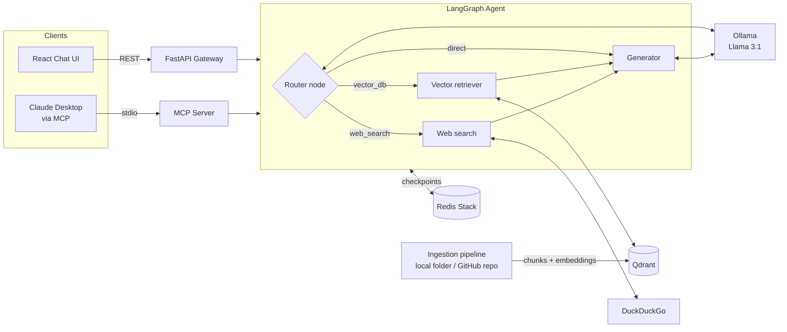

# ContextEngine

**A local-first, multi-agent RAG assistant that lets you chat with your own documents and codebases — exposed as a REST API, a React chat UI, and an MCP server for Claude Desktop.**

ContextEngine indexes local folders or any public GitHub repository into a Qdrant vector database, then answers questions through a LangGraph agent that decides, per query, whether to search your indexed knowledge, search the web, or answer directly. Conversation memory persists across turns in Redis, and everything — LLM, embeddings, vector store — runs locally via Ollama and Docker. No paid API keys required.

      

<!-- TODO: add a screenshot or GIF of the chat UI here, e.g.  -->

---

## Features

- **Agentic query routing** — a LangGraph state machine classifies each question (via structured LLM output) and routes it to vector retrieval, live web search (DuckDuckGo), or direct generation.
- **Index any GitHub repo** — shallow-clones a public repository, filters out build artifacts and oversized files, chunks 20+ source file types, and embeds them with file-path and repo metadata for source-aware answers.
- **Index local docs** — ingest `.md`, `.txt` and `.py` files from any folder.
- **Multi-turn memory** — conversation state is checkpointed to Redis Stack per session (`thread_id`), so follow-up questions keep their context across requests and restarts.
- **Three interfaces, one core:**
  - **REST API** (FastAPI) — `/api/chat` and `/api/index-git`
  - **React chat console** (Vite + Tailwind) — chat, see which route the agent chose, and index repos from the sidebar
  - **MCP server** — use ContextEngine as a tool inside Claude Desktop or any MCP client
- **Fully local** — Llama 3.1 for generation and `mxbai-embed-large` for embeddings, served by Ollama.
- **Containerized** — multi-stage Docker build with a non-root runtime user; Docker Compose wires the API, Qdrant and Redis together, with automatic discovery of the host's Ollama through Docker bridge gateways.
- **Graceful degradation** — if Ollama or Qdrant can't be reached, nodes fall back instead of crashing the request.

## Architecture



**Request flow:** a question arrives through the API or MCP → the router classifies it → the chosen node gathers context (top-4 similar chunks from Qdrant, or web results) → the generator answers grounded in that context → the full state is checkpointed to Redis under the session's `thread_id`.

**Ingestion flow:** files are loaded → split with `RecursiveCharacterTextSplitter` (1000-char chunks, 150–200 overlap) → embedded with `mxbai-embed-large` (1024-dim) → stored in the `context_engine_docs` collection with cosine distance.

## Tech stack

| Layer | Technology |
|---|---|
| Agent orchestration | LangGraph, LangChain |
| LLM & embeddings | Ollama — Llama 3.1, mxbai-embed-large |
| Vector database | Qdrant |
| Session memory | Redis Stack (`langgraph-checkpoint-redis`) |
| API | FastAPI, Uvicorn, Pydantic |
| Tool protocol | Model Context Protocol (MCP) Python SDK |
| Frontend | React 19, Vite, Tailwind CSS |
| Repo ingestion | GitPython |
| Infrastructure | Docker (multi-stage), Docker Compose |

## Project structure

```
context-engine/
├── app/
│   ├── agents/          # LangGraph state, nodes (router, retriever, web search, generator) and graph
│   ├── core/            # Settings and LLM client with host-network resolution + fallback
│   ├── db/              # Qdrant client and collection setup
│   ├── mcp/server.py    # MCP server exposing ContextEngine as tools
│   ├── services/        # Local-folder and GitHub-repo ingestion pipelines
│   └── main.py          # FastAPI app
├── context-engine-ui/   # React + Vite chat console
├── documents/           # Sample documents for local ingestion
├── Dockerfile
├── docker-compose.yml
├── run_api.py           # Starts the API
└── run_ingestion.py     # Indexes ./documents
```

## Getting started

### Prerequisites

- [Docker](https://www.docker.com/) and Docker Compose
- [Ollama](https://ollama.com/) running on the host, with the models pulled:
  ```bash
  ollama pull llama3.1
  ollama pull mxbai-embed-large
  ```
- Node.js 18+ (for the UI)

### 1. Configure

Create a `.env` file in the project root (defaults shown):

```env
OLLAMA_BASE_URL=http://127.0.0.1:11434
QDRANT_HOST=127.0.0.1
QDRANT_PORT=6333
REDIS_HOST=127.0.0.1
REDIS_PORT=6380
```

### 2. Start the backend

```bash
docker compose up --build
```

This starts the API on `http://localhost:8000`, Qdrant on `6333` and Redis Stack on `6380`. Interactive API docs are at `http://localhost:8000/docs`.

### 3. Index something

Index a GitHub repository:

```bash
curl -X POST http://localhost:8000/api/index-git \
  -H "Content-Type: application/json" \
  -d '{"repo_url": "https://github.com/<owner>/<repo>", "branch": "main"}'
```

Or index the local `documents/` folder (run outside Docker with a Python env):

```bash
pip install -r requirements.txt
python run_ingestion.py
```

### 4. Chat

```bash
curl -X POST http://localhost:8000/api/chat \
  -H "Content-Type: application/json" \
  -d '{"message": "How does authentication work in this repo?", "thread_id": "demo-session"}'
```

Response:

```json
{ "response": "...", "thread_id": "demo-session", "router_decision": "vector_db" }
```

Reuse the same `thread_id` to continue the conversation with memory.

### 5. Run the UI

```bash
cd context-engine-ui
npm install
npm run dev
```

## Using it from Claude Desktop (MCP)

Add ContextEngine to your Claude Desktop config (`claude_desktop_config.json`):

```json
{
  "mcpServers": {
    "context-engine": {
      "command": "python",
      "args": ["/absolute/path/to/context-engine/app/mcp/server.py"]
    }
  }
}
```

Exposed tools:

| Tool | What it does |
|---|---|
| `ask_context_engine(query, session_id)` | Runs a question through the agent graph with persistent session memory |
| `index_local_knowledge_base(directory_path)` | Ingests a local folder into Qdrant |
| `index_remote_github_repository(repository_url, branch_name)` | Clones and ingests a public GitHub repo |

The MCP server writes all logs to stderr so they never corrupt the stdio JSON-RPC channel.

## API reference

| Method | Endpoint | Body | Description |
|---|---|---|---|
| `POST` | `/api/chat` | `{ message, thread_id? }` | Ask a question; returns the answer, session id and the route taken |
| `POST` | `/api/index-git` | `{ repo_url, branch? }` | Clone, chunk, embed and store a public GitHub repo |

## Roadmap

- [ ] Self-correction loop: grade retrieved chunks for relevance and re-route to web search when they miss
- [ ] Retrieval evaluation (hit rate / answer faithfulness) on a fixed question set
- [ ] Streaming responses to the UI
- [ ] Per-repository collections and metadata filtering
- [ ] Automated tests and CI with GitHub Actions

## Author

**Fahim Takin** — [Portfolio](https://fahimtakin.vercel.app) · [GitHub](https://github.com/fahimtakin) · [LinkedIn](https://linkedin.com/in/fahim-takin)
